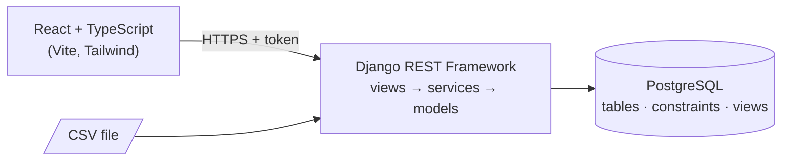
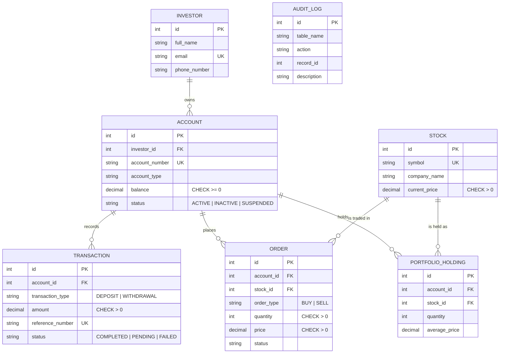

# Investment Management System

[](https://github.com/quintuckyy/Investment-Database-System/actions/workflows/ci.yml)

A full-stack portfolio project that showcases **relational database design** and **REST API development**. I designed the PostgreSQL database architecture (schema, relationships, constraints, views, reporting and validation queries) and built a RESTful API with Django REST Framework, consumed by a React + TypeScript frontend.

It models a small brokerage: investors own accounts, accounts make deposits, withdrawals and stock orders, and every change is recorded in an audit log.

## Highlights

| Area | What it demonstrates |
| --- | --- |
| **Database design** | Normalised schema, foreign keys, unique and `CHECK` constraints, SQL views for reporting, standalone SQL scripts for tables, sample data, indexes, views, reports and validation queries |
| **Data integrity** | Balances change only through a service layer that runs in a database transaction with row locking (`SELECT … FOR UPDATE`), so two simultaneous withdrawals can never overdraw an account. A concurrency test proves it. |
| **REST API** | Django REST Framework, token authentication, role-based permissions, search / filter / ordering, opt-in pagination, OpenAPI docs at `/api/docs/` |
| **ETL** | CSV import that validates every row, reports each failure with its line number, and never lets one bad row block the good ones |
| **Data quality** | Validation endpoints, including a **balance reconciliation** check that recomputes every balance from the ledger and flags any difference |
| **Quality & delivery** | 92 backend tests + 21 frontend tests, linting (Ruff, ESLint), GitHub Actions CI, Docker Compose |

## Architecture



Request flow: `React page → axios client → /api/... → Django view → service layer (transaction + audit log) → PostgreSQL`.

## Database design



- **One investor can own many accounts** (one-to-many); each account belongs to exactly one investor.
- `portfolio_holdings` is unique per `(account, stock)`.
- `audit_logs` is an append-only trail written by the service layer.
- Deletes are protected: you cannot delete an investor, account or stock that still has dependent records (`on_delete=PROTECT` in Django, matching the default `NO ACTION` of the SQL foreign keys). The API answers `409 Conflict` with an explanation instead of silently cascading.
- Reporting views (`view_account_summary`, `view_transaction_summary`, `view_deposit_withdrawal_summary`, `view_portfolio_summary`, `view_order_summary`) are defined once in [`database/04_create_views.sql`](database/04_create_views.sql) and loaded by Django migration `0003_reporting_views`.

### Two ways to create the database

1. **Django migrations (recommended, used by Docker and CI).** `python manage.py migrate` creates the tables, constraints and views. The `database/*.sql` files are not needed.
2. **Standalone SQL scripts.** The numbered files in [`database/`](database) build the same design in plain SQL, which is useful for studying or reviewing the schema without Django: `01_create_tables`, `02_insert_sample_data`, `03_create_indexes`, `04_create_views`, `05_reports`, `06_data_validation`.

## Quick start

### Option A: Docker (one command)

```bash
docker compose up --build
```

| | URL |
| --- | --- |
| App | http://localhost:8080 |
| API docs (Swagger) | http://localhost:8000/api/docs/ |
| Django admin | http://localhost:8000/admin/ |

Demo logins (created with the sample data, for evaluation only): `admin` / `admin12345` (staff, can edit) and `viewer` / `viewer12345` (read-only). Set `SEED_SAMPLE_DATA=false` to start empty.

### Option B: Run locally

You need Python 3.12+, Node 22+ and PostgreSQL.

```bash
# 1. Database
#    Create an empty database named investment_db in PostgreSQL.

# 2. Backend
cd backend
python -m venv venv
venv\Scripts\activate            # macOS/Linux: source venv/bin/activate
pip install -r requirements-dev.txt
cp .env.example .env             # then edit DB_PASSWORD and SECRET_KEY
python manage.py migrate
python manage.py seed_sample_data --with-demo-users   # demo data + logins (optional)
python manage.py createsuperuser                      # or create your own staff user
python manage.py runserver

# 3. Frontend (new terminal)
cd frontend
npm install
cp .env.example .env             # optional: only needed to change the API URL
npm run dev
```

Open http://localhost:5173 and sign in. Upgrading an existing database from an earlier version of this project: run `python manage.py migrate`, then create a user with `createsuperuser`.

## Authentication and roles

Every endpoint requires a token (`Authorization: Token <token>`), obtained from `POST /api/auth/login/`. Login attempts are rate-limited.

| Role | Can do |
| --- | --- |
| **Viewer** (any signed-in user) | Read everything: lists, reports, validation checks, audit logs |
| **Staff** (`is_staff`) | Everything a viewer can, plus create / edit / delete investors, accounts and stocks, create transactions and orders, import CSV files |

The frontend hides controls the signed-in role cannot use, and the API enforces the same rules.

## Key design decisions

- **Money moves only through services.** `TransactionService` and `OrderService` lock the account row, validate, write the record, update the balance and write the audit log inside one database transaction. Transactions, orders, holdings and audit logs are therefore **read-only** through the generic REST endpoints, and an account's `balance` cannot be set directly through the API.
- **Reconcilable by design.** A balance always equals completed deposits − withdrawals − buys + sells. `GET /api/validation/balance-reconciliation/` recomputes this in SQL and returns every account where it does not hold. The seed data reconciles to zero differences.
- **Only completed records count.** `PENDING` and `FAILED` transactions and orders are stored but do not change balances or holdings, and the reporting views ignore them in totals.
- **The database defends itself.** `CHECK` constraints reject negative balances, non-positive amounts, quantities and prices even if application code is bypassed.
- **Backward-compatible pagination.** List endpoints return a plain array by default; add `?page=` or `?page_size=` to get `{count, next, previous, results}`.
- **Friendly failures.** The API returns specific messages (`Withdrawal of ₱5,000.00 exceeds the available balance of ₱1,200.00`), bad input returns `400` / `404` rather than a server error, and the UI shows field-level errors.

## API

Interactive documentation: **`/api/docs/`** (Swagger UI) and **`/api/schema/`** (OpenAPI).

| Resource | Endpoint | Methods |
| --- | --- | --- |
| Investors, Accounts, Stocks | `/api/investors/`, `/api/accounts/`, `/api/stocks/` | `GET` (all), `POST` `PUT` `PATCH` `DELETE` (staff) |
| Transactions, Orders, Holdings, Audit logs | `/api/transactions/`, `/api/orders/`, `/api/portfolio-holdings/`, `/api/audit-logs/` | `GET` only |
| Create transaction | `/api/transactions/create/` | `POST` (staff) |
| Create order | `/api/orders/create/` | `POST` (staff) |
| Import CSV | `/api/etl/import-transactions/` | `POST` multipart (staff) |
| Reports | `/api/reports/account-summary/`, `transaction-summary/`, `deposit-withdrawal-summary/`, `portfolio-summary/`, `pending-orders/`, `failed-transactions/` | `GET` |
| Data validation | `/api/validation/duplicate-transactions/`, `negative-balances/`, `transaction-status/`, `order-status/`, `accounts-without-transactions/`, `investors-without-accounts/`, `balance-reconciliation/` | `GET` |
| Auth | `/api/auth/login/`, `/api/auth/logout/`, `/api/auth/me/` | `POST`, `POST`, `GET` |

List endpoints support `?search=`, `?ordering=` (prefix `-` to reverse) and exact filters such as `?status=FAILED`, `?account_id=1`, `?investor_id=1`.

```bash
TOKEN=$(curl -s -X POST localhost:8000/api/auth/login/ -d username=admin -d password=admin12345 | jq -r .token)
curl -H "Authorization: Token $TOKEN" "localhost:8000/api/transactions/?status=FAILED&ordering=-amount"
```

### CSV import

Required columns: `account_id, transaction_type, amount, reference_number, status` (a sample is in [`etl/sample_transactions.csv`](etl/sample_transactions.csv)).

- A wrong **file** (not `.csv`, empty, not UTF-8, over 5 MB, or missing required columns) is rejected up front with a `400` that names the problem. Nothing is imported.
- A wrong **row** (bad amount, unknown account, overdraft, duplicate reference, …) is skipped and reported with its line number; every other row is still imported. Rows are saved independently, so re-uploading a file rejects the rows that already imported as duplicates.

## Testing and quality

```bash
cd backend  && python manage.py test        # 92 tests against a real PostgreSQL test database
cd backend  && ruff check .                 # lint
cd frontend && npm test                     # 21 unit tests (Vitest + Testing Library)
cd frontend && npm run lint && npm run build
```

The backend suite covers the services (balances, rollbacks, weighted-average cost, audit logs), the API (authentication, permissions, filtering, pagination, error handling), the CSV importer (wrong formats and bad rows), database constraints, the SQL reports and validation views, and a multi-threaded **race-condition test** for concurrent withdrawals. GitHub Actions runs everything on each push and pull request.

## Project structure

```
backend/
  investment_backend/        Django project settings and root URLs
  investments/
    models.py                Tables, constraints, relationships
    services.py              Transaction + order business logic (atomic, row-locked)
    serializers.py           JSON <-> model conversion and validation
    permissions.py           Staff-vs-viewer rules
    views/                   crud.py · actions.py · reports.py · validation.py · auth.py
    management/commands/     seed_sample_data
    migrations/              Schema, constraints, SQL views
    tests/                   Services, API, CSV import, reports, concurrency
database/                    Standalone SQL: tables, sample data, indexes, views, reports, validation
etl/                         Sample CSV for the importer
frontend/src/
  api/ auth/ hooks/ utils/   API client, login state, data hook, error + CSV helpers
  components/ pages/ layouts/
docker-compose.yml           Database + backend + frontend
.github/workflows/ci.yml     Lint, test, build, audit
```

## Known limitations and next steps

- Authentication uses simple per-user API tokens. For production I would move to short-lived JWTs or sessions behind HTTPS, add password reset, and finer-grained permissions.
- Stock prices are entered by hand; a market-data integration (a price-refresh job calling an external quote API) is the natural next feature.
- List pages filter in the browser; the API already supports server-side search and pagination, which the UI should adopt as data grows.
- Dev-only advisories remain in Tailwind 3's build tooling (`npm audit`); they need a Tailwind 4 upgrade and do not ship to users.
